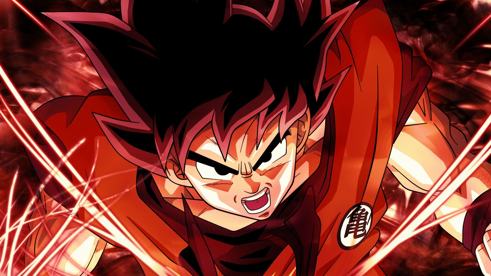

# Goku Ultra Instinct Reveal

An interactive Dragon Ball-themed webpage showcasing Goku's transformation into Mastered Ultra Instinct. Move your mouse across the screen to reveal the base form Goku emerging from the Ultra Instinct aura with a stunning trail effect.

## Preview



## Features

- **Interactive Canvas Effect** - Mouse/touch movement reveals base form Goku (1.jpg) over Mastered Ultra Instinct (2.jpg) with a dynamic radial trail
- **Smooth Animations** - 60fps animation loop with eased mouse tracking and fading trail particles
- **Responsive Design** - Works on desktop and mobile devices (touch support)
- **Custom Typography** - Uses Google Fonts (Bangers, Bebas Neue, Luckiest Guy, Cormorant Garamond) for authentic Dragon Ball aesthetic
- **Glow Effects** - Radial gradient glow follows the cursor for added visual impact
- **Zero Dependencies** - Pure HTML, CSS, and vanilla JavaScript (no frameworks)

## Demo

Open `index.html` in any modern browser to experience the interactive transformation.

## Project Structure

```
Goku/
├── index.html      # Main HTML file with embedded CSS & JS
├── 1.jpg           # Base form Goku (revealed on hover)
├── 2.jpg           # Mastered Ultra Instinct Goku (base layer)
└── README.md       # This file
```

## How It Works

The effect uses two canvas layers:
1. **Bottom layer** - Always visible Mastered Ultra Instinct image (2.jpg)
2. **Top layer** - Base form Goku (1.jpg) revealed through a composite operation

As you move the mouse, a trail of circular masks is created. The top image is drawn using `source-in` composite operation, making it visible only within the trail circles. A dark overlay and radial glow complete the dramatic effect.

## Customization

To use your own images:
1. Replace `1.jpg` with your "revealed" image (top layer)
2. Replace `2.jpg` with your "base" image (bottom layer)
3. Update the image paths in the JavaScript if using different filenames

```javascript
bottom.src = 'your-base-image.jpg';
top.src = 'your-reveal-image.jpg';
```

## Browser Support

- Chrome 60+
- Firefox 55+
- Safari 11+
- Edge 79+

Requires Canvas 2D API and `requestAnimationFrame` support.

## License

This is a fan project for educational/demonstration purposes. Dragon Ball characters are property of Toei Animation, and Akira Toriyama.
